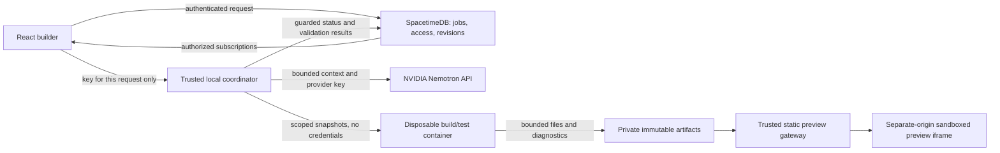

# Nemotron generation and build/preview sandbox plan

November 7, 2026. Status: proposal for review, not approved infrastructure or implemented generation. Owner selected planning the complete sandbox before connecting the draft-only generation service. This supersedes proceeding immediately with the proposed draft-only slice.

## Subsequent implementation direction

The owner asked for a simple SpacetimeDB backend and open-ended framework support, discussed Sandpack, then authorized implementation with mocked providers and account configuration later. E2B is the hosted execution candidate; Docker Desktop is not an approved product requirement. The original local-container recommendations below are retained as planning history, not adopted infrastructure.

The first implemented slice is a real SpacetimeDB job lifecycle and Library inspection UI with simulated provider/build/test stages and a trusted isolated HTML fixture preview. It does not generate framework code, compile anything, invoke E2B or promote artifacts. NVIDIA transport and an injected E2B SDK-controller adapter have mocked contract tests; they are not wired to a live backend workflow. Protected hosted-preview routing, worker authority, actual toolchains, real validation and revision promotion remain required follow-ups.

## Goal and current evidence

Generate reusable Common components/compositions for the project's requested technologies, build/test the actual files, preview those same files, and promote only successful complete changes. Failed attempts preserve the current working library. Arbitrary technology requests are permitted; initial end-to-end verification remains required for React + TypeScript + Tailwind + shadcn/ui and Blazor + Bootstrap. Neither profile is the full catalog.

Existing: project identity/grants, requested technology details, saved questionnaire/design guidance, project-scoped reference uploads. No job orchestration, isolated execution, artifact store, executable preview or promotion model exists yet. Independent NVIDIA transport/context helpers and three mocked tests have been prepared; they make no live provider calls and are not connected to the application.

Verified locally: Docker CLI/engine 29.8.1, Docker Desktop 4.93.0, Linux engine on WSL2 are available. Read-only engine inspection succeeded outside the filesystem sandbox. A sandbox-only Docker denial was not evidence that Docker was missing. No host .NET SDK or Podman found. Host .NET is unnecessary if the toolchain is containerized. No images were pulled, containers launched or system tools installed for this planning task.

## Proposed trust boundaries

The coordinator alone can orchestrate Docker and contact NVIDIA. Neither the model nor generated code receives a Docker socket, host filesystem access, database credentials or OAuth/provider tokens. SpacetimeDB enforces authorization and job/revision transitions; model output is not an authorization or validation proof.

A local coordinator is an external integration responsibility, not a return to Flask/SQLite or a second application database. Its deployment, authentication and memory-only key proposal still require agreement before implementation. A distinct trusted worker identity with narrowly scoped claim/report operations is required before authoritative validation/promotion; do not let a normal client claim its own draft passed checks.

## Complete job lifecycle

1. An editor requests generation; module checks project access and allows one modifying attempt per project. Snapshot requested technologies, design revision, references and starting library revision. Disclose which material goes to NVIDIA.
2. Resolve the requested configuration and missing choices. Agent may propose compatible dependencies/toolchains and ask focused questions. Do not silently substitute a different framework/library.
3. Coordinator calls Nemotron with bounded context and a budget. References are untrusted data, not instructions to acquire secrets or change authority. Provider response errors and reasoning are not copied into user logs. No automatic unlimited retry/spend.
4. Parse a draft manifest of relative file paths/content, dependencies, public API, examples and documentation. Reject absolute/traversal/drive paths, symlinks, device files, reserved paths, excessive file counts/sizes, and attempts to replace the runner, policies or Dockerfile. The agent supplies project files, not container privileges.
5. Prepare pinned dependencies in the restricted dependency stage below.
6. Run clean build, type/contract/dependency checks and relevant interaction tests in a fresh credential-free offline container. Collect bounded output with no secrets. Treat diagnostics as untrusted text too.
7. Feed failures to Nemotron for at most two proposed repair attempts, rechecking access, budgets and starting revisions. Keep diagnostics tied to the attempt that produced them.
8. Start a preview of the exact tested artifact and exercise it in a separately isolated browser context. User sees candidate/current labels; screenshots are not a substitute for interaction checks.
9. Write immutable candidate artifacts, then a short guarded transaction verifies worker authority, active attempt, current project inputs and required results before advancing the complete change set. Code, docs, examples and exports must reference the same revision. This step needs the new revision/change-set model, not today's guidance-save reducer.
10. Failed, cancelled or stale work leaves current pointers unchanged. Leases/timeouts make abandoned attempts recoverable. Never repeat a provider call automatically just because the caller lost its HTTP response.

Proposed states: queued, preparing, generating, validating, repairing, preview-ready, current, failed, cancelled, needs-clarification and needs-toolchain. Build-unavailable output may be retained as an explicitly unverified draft; it cannot become current through the verified-success path.

## Dependency preparation

Start with maintained, digest-pinned toolchain images and exact dependency manifests/lockfiles for both required profiles. Pin actual patch versions/image digests when the runner is built; do not use floating latest tags. Bootstrap/shadcn assets are local, not CDN script injection.

Separate downloads from evaluation of generated project files. A trusted resolver fetches only approved package names/versions from fixed npm/NuGet registries into a per-job dependency bundle. Generated code does not run with unrestricted network access. A Docker bridge network alone is not an outbound allowlist.

For unfamiliar libraries, resolve a package plan first, then approve new dependency/toolchain capabilities under policy. npm lifecycle scripts are disabled by default; required package setup is an explicit runner capability. NuGet/MSBuild targets and source generators are executable too: never restore an arbitrary generated project on the host. Avoid trusted credential-bearing registry access in any stage that can evaluate package/project code. Initial images can bake in the two known dependency sets so the first build path is entirely offline.

This is not a claim that arbitrary npm/NuGet dependencies are safe. New packages may require reviewed setup or an additional image. A project request remains valid even when its verification harness is pending.

## Build and test container

Recommended initial configuration:
- Non-root user, no privileged mode, drop Linux capabilities and set no-new-privileges; retain the default seccomp policy unless a specific reviewed tool requires adjustment.
- Read-only root filesystem; job-only writable workspace/temp storage. No repository root, home directory, .local keys/data, .env, host Docker socket or unrelated project mounts. Copy only the authorized snapshot into a disposable workspace.
- Network disabled during compile/test. No host networking or host-published build ports.
- Start with 2 CPU, 4 GiB memory, 256 PIDs and five-minute build deadlines; tune from measured React/Blazor evidence. Bound log/artifact sizes. Docker CPU/memory limits do not by themselves bound all disk writes: size-bound temporary volumes and enforce artifact/workspace limits separately.
- Fixed runner commands invoked as argument arrays, not model-provided shell strings. MSBuild/Vite/plugins still execute untrusted code inside the boundary.
- A fresh workspace/container for every attempt. Treat dependency cache contents as untrusted; no project files or credentials in shared writable caches.

Docker is a practical local-prototype boundary, not a claim of protection against every hostile tenant or kernel/container escape. Public multi-tenant execution needs a separately reviewed stronger VM/microVM/remote-runner boundary before deployment. The privileged Docker controller must remain trusted and loopback-only.

## React and Blazor runners

React runner: pinned Node/npm, TypeScript, React, Vite and the tested Tailwind/shadcn dependency set; compile the component with trusted example host and exercise events/state/keyboard behavior. MUI changes dependency/style conventions while reusing the React host where compatible.

Blazor runner: recommend standalone Blazor WebAssembly plus Bootstrap for the first preview harness; pin the supported .NET SDK/runtime/workloads and local assets. Build/publish in the container and serve static output. No generated ASP.NET backend or application authentication is required for reusable component examples. Blazor hosting/render mode is a recommendation here, not an accepted project-wide restriction.

Framework-specific adapters supply tooling, harness and checks, not a finite template catalog or a restriction on project metadata. Angular can add an Angular runner/harness; unfamiliar languages can request a new pinned toolchain image. The model may attempt any configuration, but the coordinator cannot grant arbitrary commands, downloads or runtime privileges. If a configuration is incompatible or cannot yet be built, explain the blocker and retain the working revision.

## Browser preview boundary

Building in a container does not isolate JavaScript running in the user's browser. Serve artifacts through a trusted static gateway on an origin distinct from the builder, with no builder cookies/tokens or database/NVIDIA configuration in the output.

Proposed local approach: a fresh loopback preview origin per active attempt (distinct host/port), never reused for unrelated artifacts during its lifetime. Authorize the parent user before issuing a short-lived preview access mechanism. Do not put the user's OAuth/NVIDIA token in a preview URL, cookie, iframe, postMessage or generated files. Exact preview-session mechanism must be validated before implementation; a different port alone is not authorization.

Use sandboxed iframes with scripts only as required. If Blazor/modules need same-origin fetch, allow-same-origin is permitted only on the separate preview origin, never the builder origin. Do not grant top navigation, popups, downloads or form submissions by default. Use a strict CSP/Permissions-Policy and no-store responses. Block external image/font/script/frame/form destinations; allow only needed same-origin assets. Blazor WebAssembly may need wasm-unsafe-eval; avoid broad unsafe-eval. Test the chosen CSP against the exact pinned runtime.

A plain CSP connect-src self still permits requests to every gateway path on that preview origin. The gateway therefore serves only that attempt's approved static artifact, no proxy/API/other project paths, rejects writes and enforces its preview authorization. The isolated automated browser also blocks outbound requests in its test network. Verify browser-origin/storage separation, revocation, blocked navigation and attempted exfiltration; do not promise CSP completely contains malicious code or prevents resource exhaustion. Parent messaging is a minimal validated ready/error protocol with exact source/origin checks.

## Artifacts, cleanup and recovery

Propose an ignored private local artifact directory managed only by trusted code, outside generated working directories. Immutable attempt/revision IDs, bounded file manifests, validated relative paths and content hashes. Original project references remain in SpacetimeDB; generated code cannot query the database for more files.

Copy out only regular files beneath approved output roots; reject symlinks/path escapes, limit count/bytes and refuse executable server entrypoints for static previews. Artifact availability/integrity must be checked before DB promotion; filesystem and DB writes are not one transaction. Reconcile prepared/orphaned artifacts and retain current/recovery revisions after crashes. Exact code/artifact quotas, backup and latest-change undo/redo behavior must be finalized with the revision model.

Terminate timed-out containers/browser contexts, remove disposable workspaces, expire preview sessions and preserve bounded diagnostic records. Never delete current/recovery artifacts as generic job cleanup. No customer key or JWT is written into logs, manifests, artifacts or exports.

## Implementation increments and acceptance

A. Sandbox proof, before live model calls: trusted tiny React and Blazor fixtures build and mount in the proposed boundaries. Deliberately hostile fixtures cannot read host sentinel files, credentials, Docker socket or other jobs; cannot reach external or application endpoints; process/resource/time limits terminate runaway work. A preview cannot read parent storage, navigate the top page or open another project's artifacts. This phase validates the mechanism without claiming a generation agent exists.

B. Coordinator/jobs/key handling: authenticated editor-only job creation, worker claim/leases/report authorization, one modifying attempt per project, cancellation/restart recovery, bounded context/budget and memory-only provider-key lifetime. Viewer/outsider requests and forged successful validations are denied. Keys never enter stored job arguments, snapshots or client subscriptions.

C. Actual Nemotron generation: request Common Button/Input (inventory still proposed), compile/test/preview both required stacks, inspect artifacts and perform bounded repairs. Test failed generation and stale inputs preserve the current library; successful whole-change promotion keeps files/docs/examples synchronized. Also exercise an unfamiliar configuration to prove requests are not rejected solely for lacking a preset; unverified output stays visibly unverified.

D. Recovery/export integration: implement the agreed latest complete change-set undo/redo and verify exported files correspond to tested current revisions. Broader framework support proceeds by measured runner capability, not dropdown claims.

## Historical proposals before the current chat increment

Historical proposal (not approved; client-supplied credentials superseded by the correction below): local Docker Desktop Linux containers for the prototype, Blazor WebAssembly for its static preview, offline builds from pinned images, separate-origin static previews, and a local trusted coordinator holding a client-supplied NVIDIA key only for the active request. These remain recommendations; the owner selected planning first, not approval of this package.

Still open: worker authentication/enrollment; exact preview-session/origin/CSP mechanism; budgets and retry/time/resource/artifact caps; dependency approval policy and unfamiliar-toolchain handling; key cancellation/restart behavior; artifact revision/recovery design; initial Common inventory. Prove the boundary in increment A before running generated code or claiming these choices are secure. Image/toolchain versions and image download size are selected during implementation, with no system installation or paid provider calls assumed.

## Official sources consulted

- NVIDIA hosted model/API: https://docs.api.nvidia.com/nim/reference/nvidia-nemotron-3_5-super-vl-120b-a12b and https://docs.api.nvidia.com/nim/reference/nvidia-nemotron-3_5-super-vl-120b-a12b-infer
- Docker resource/filesystem/network/privilege options: https://docs.docker.com/engine/containers/run/
- Docker boundaries/daemon attack surface: https://docs.docker.com/engine/security/
- Docker Desktop Windows/WSL: https://docs.docker.com/desktop/setup/install/windows-install/ and https://docs.docker.com/desktop/features/wsl/
- Blazor CSP/runtime requirements: https://learn.microsoft.com/en-us/aspnet/core/blazor/security/content-security-policy

These sources verify platform capabilities, not an implemented ComPlix sandbox or approval of infrastructure. No claims of current generation/build/preview validation follow from this plan.

## Credential correction - confirmed owner direction, November 7, 2026

ComPlix supplies built-in project chat with operator-managed provider credentials. Earlier client-supplied key proposals and the temporary key-entry UI are superseded. The current bounded chat integration calls NVIDIA directly from a SpacetimeDB procedure using protected backend environment configuration; generated execution never receives this credential. E2B runner credentials, when introduced, must likewise remain operator-side. Sandbox builds/previews are still unimplemented; refer to decisions.md decision 27 and README for the actual chat boundary.
